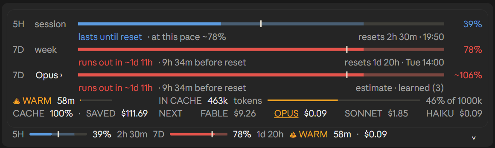

# usage-ribbon

[English](README.md) · **Hrvatski**

Besplatni mod za Claude Code. Iznad polja za prompt dodaje usku traku koja pokazuje:

- **Koliko si potrošio od 5-satnog i 7-dnevnog limita**, kad se svaki resetira i hoćeš li ovim tempom stići do reseta.
- **Kako bi ti tjedan izgledao na drugom modelu**: odaberi Fable, Opus, Sonnet ili Haiku i vidi bi li te isti posao na tom modelu doveo do limita prije reseta.
- **Je li cache prompta topao ili hladan**, koliko košta sljedeća poruka i koliko ti je cache uštedio.

Instalira se jednom i nakon toga je u svakoj sesiji. Nema naredbi za učenje. Traka može biti na **engleskom** ili **hrvatskom** (vidi [Jezik](#jezik)).

<p align="center">
  
</p>

Na snimci je traka na engleskom. Na hrvatskom su isti brojevi, samo s hrvatskim natpisima.

## Instalacija

Najlakše: pošalji ovu poveznicu svom agentu i reci mu „instaliraj ovo”.

```
https://github.com/premazg-lab/usage-ribbon
```

### Za agente

Ako si agent i korisnik te je zamolio da ovo instaliraš, pokreni u ljusci:

```
claude plugin install usage-ribbon --marketplace premazg-lab/usage-ribbon
```

Instalira se za korisnika (svi njegovi projekti) i sam doda marketplace. Zatim korisniku reci: „usage-ribbon je instaliran. Pokreni novu sesiju da vidiš traku iznad prompta.” Ne uređuj ručno njegovu datoteku postavki.

### Ručno

U terminalskoj sesiji Claude Codea upiši:

```
/plugin install usage-ribbon --marketplace premazg-lab/usage-ribbon
```

1. Upiši `y` kad pita `Add marketplace?`.
2. Odaberi opseg **user** tipkom Enter.
3. Pokreni novu sesiju.

U desktop aplikaciji, gdje `/plugin` ne radi: klikni **+** pored polja za prompt, zatim **Plugins**, **Add marketplace** s `premazg-lab/usage-ribbon`, pa **Add plugin**.

## Jezik

Traka je zadano na engleskom. Za hrvatski postavi opciju plugina **Language** na `hr` (`en` vraća engleski). U terminalskoj sesiji otvori `/config` i nađi red **usage-ribbon · Language**. Natpisi u ovom README-u su hrvatski; engleski su u [README.md](README.md).

## Što vidiš

### Zatvorena traka

Jedan red:

```
5H ▬▬▬|▭▭ 26%  3h 21m   7D ▬▬▬▬▬|▭ 77%  1d 21h   ♨ TOPLO 59m · $0.08   ⌃
```

- **5H** je 5-satni prozor, **7D** 7-dnevni. Svaki pokazuje koliko si **potrošio** i koliko je do reseta.
- **TOPLO** s minutama koliko cache još ostaje topao i koliko košta sljedeća poruka, ili **HLADNO** s cijenom na prvom mjestu i koliko je dugo hladan.
- Strelica desno otvara karticu.

### Kako čitati crtu

Svaka crta radi isto:

- **Puna boja** je ono što si potrošio.
- **Svjetliji nastavak** pokazuje gdje ćeš biti na resetu ako nastaviš istim tempom.
- **Tanka bijela crtica** pokazuje koliko je prozora prošlo.

Boja odmah kaže zaključak:

- **Plava**: stižeš do reseta.
- **Jantarna**: tijesno, završit ćeš između 80% i 100%.
- **Crvena**: ovim tempom zapest ćeš prije reseta. Kartica kaže kada.

### Otvorena kartica

Tri crte, svaka s redom ispod:

- **5H sesija** i **7D tjedan**: zaključak (`stižeš do reseta`, `tijesno` ili `zapest ćeš za ~1d 12h · 9h 25m prije reseta`) i kad se prozor resetira.
- **7D model**: isti tjedan, ali kao da si sav posao radio na jednom modelu. Prati model koji koristiš. Klikni ime za drugi model. Taj odabir vrijedi dok ne promijeniš model ili zatvoriš karticu. Označeno je kao **procjena**, jer Claude Code ne javlja tjedni limit po modelu (više ispod).

Ispod crta je cache:

- **TOPLO 58m** s malom crtom koliko dugo miruješ, ili **HLADNO** s time koliko je dugo hladan.
- **CACHE 97% · UŠTEDA $14.90**: koliki je dio ulaza zadnjeg odgovora došao iz cachea i koliko ti je cache uštedio u ovoj sesiji.
- **U CACHEU 402k tokena**, s time koliki je to dio konteksta.
- **SLJEDEĆA**: koliko košta sljedeća poruka na svakom modelu. Tvoj trenutni model je podcrtan. Samo tvoj model čita iz toplog cachea; svaki drugi mora cijeli razgovor ponovno upisati u cache.

### Radi na svakoj površini

- **Desktop aplikacija**: crte su nacrtane i rastežu se preko cijele širine trake.
- **Terminal**: isti podaci kao tekstualne crte.

## Kako radi procjena po modelu

Claude Code javlja samo dva limita: 5-satni i 7-dnevni prozor. Tjednog podatka po modelu nema, pa je treća crta procjena, napravljena u dva koraka:

1. **Po cijenama.** Mod bilježi tokene svakog odgovora u zadnjih 7 dana. Te tokene preračuna po cijeni odabranog modela i za tu razliku poveća ili smanji ostatak tvog 7-dnevnog tempa. Sonnet, upola jeftiniji od Opusa, ispadne s otprilike upola manje dodatne potrošnje.
2. **Naučeno.** Svaki put kad 7-dnevni postotak naraste za jedan, mod taj postotak pripiše modelu koji je od prošlog očitanja najviše trošio. Kad ih skupi dovoljno (3), koristi naučeno umjesto samih cijena. Natpis tada glasi `procjena · naučeno (n)`, gdje je `n` broj postotaka koje je vidio. Naučeno se čuva među sesijama.

Što ne vidi: potrošnja iz drugih sesija, s claude.ai ili preko API-ja također diže 7-dnevni postotak, pa procjena može biti malo previsoka.

## Dobro je znati

- **Ništa ne košta.** Čita brojke samog Claude Codea i crta ih. Nikad ne poziva model.
- **Cijene su procjena.** Dolaze iz tablice `PRICES` u `hooks/learn.ts`, ne s tvog računa. Ako se cijene promijene, uredi tu tablicu.
- **Pretpostavlja se da cache ostaje topao 60 minuta** nakon zadnjeg odgovora. To mijenjaš opcijom plugina **Cache lifetime (minutes)**.
- **Pozadinski agenti se broje u uštedu i učenje**, ali sat cachea i postotak pogotka postavlja samo tvoj glavni razgovor.
- **Tempo računa cijeli prozor**, uključujući noći, kao i sami limiti.

## Što je unutra

```
usage-ribbon/
├── .claude-plugin/
│   ├── plugin.json         ime moda, verzija i njegove dvije opcije
│   └── marketplace.json    čini ovaj repozitorij instalabilnim
├── hooks/
│   ├── hooks.json          upućuje na modul
│   ├── register.tsx        traka: limiti, tempo, cache, raspored
│   ├── learn.ts            tablica cijena i učenje po modelu
│   └── i18n.ts             svi natpisi trake, na engleskom i hrvatskom
├── types/index.d.ts        oblik onoga što traka pamti
├── tests/                  5 testova: toplo i hladno, tempo i cijena, učenje, hrvatski, terminal i desktop
└── assets/                 snimka
```

## Uklanjanje

```
claude plugin uninstall usage-ribbon
```

## Razvoj

Učitaj mapu bez instalacije:

```
claude --plugin-dir ./usage-ribbon
```

Pokreni testove:

```
claude plugin test ./usage-ribbon
```

## Licenca

[MIT](LICENSE). Slobodno ga koristi, mijenjaj i dijeli, uz uvjet da obavijest o autorskim pravima ostane uz njega.

Ideja trake iznad prompta dolazi od [ribbon](https://github.com/robonuggets/ribbon) autora Jay E (RoboNuggets). usage-ribbon je zaseban mod napisan od nule, s tempom, zaključcima i tjednom procjenom po modelu.

Napravio Prema.
